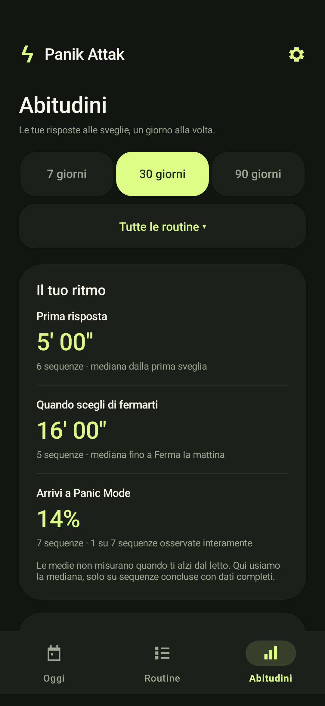

# ϟ Panik Attak

### Il letto ha perso.

Una sveglia Android che accompagna il risveglio con richiami progressivi e puzzle da risolvere. Crea routine diverse per lavoro, weekend o altre situazioni e tienile attive insieme, ognuna con i propri giorni e orari.

**Android 8+ · In italiano · Offline · Nessun account · Nessuna pubblicità**

[Scarica Alpha 5](https://github.com/lucavalentebit/panik-attak/releases/tag/v3.0-alpha.5) · [APK nella repository](Panik-Attak.apk) · [Dettagli tecnici](docs/TECHNICAL.md) · [Piano V3](docs/V3-PLAN.md)

## Novità di Alpha 5 — Abitudini

La pagina **Abitudini** ora raccoglie le tue risposte alle sveglie, mantenendo il verde lime, le superfici scure e le schede arrotondate dell’app.

- Filtri **7 / 30 / 90 giorni** e per routine, anche dopo averla rinominata o eliminata.
- Tempo mediano alla prima risposta, tempo fino a **Ferma la mattina** e frequenza di Panic Mode, con il numero di sequenze osservate.
- Grafico delle risposte e conclusioni, in minuti trascorsi oppure ora locale; distribuzione degli orari di fine, fasi e riepilogo settimanale.
- Storico consultabile: consegne, puzzle, soluzioni, conferme e motivo di conclusione.
- Impostazioni per registrazione, conservazione **30 / 90 / 365 giorni**, esportazione CSV e cancellazione dello storico.

**Lo storico parte da questo aggiornamento.** Le prove e le anteprime non contano. Le statistiche descrivono le risposte all’app, non misurano quando ti alzi dal letto. I riepiloghi mostrano “Dati ancora pochi” finché non hanno almeno cinque campioni validi.



Anteprima sul Samsung con dati di test isolati: questi esempi non vengono aggiunti al tuo storico. [Tutte le novità della release](RELEASE-NOTES-alpha5.md).

## Le pagine

- **Oggi** mostra il prossimo richiamo fra tutte le routine attive, il countdown, gli orari coincidenti e le sequenze in corso.
- **Routine** raccoglie le routine e apre una pagina dedicata a ciascuna, con tutti i controlli e i puzzle già disponibili. Il menù ⋮ gestisce nome, copia ed eliminazione.
- **Abitudini** mostra statistiche e storico delle sequenze reali, con filtri e dettagli consultabili.
- **Impostazioni**, dall’ingranaggio in alto, raccoglie volume sveglia, Non disturbare, notifiche e permessi Android. Mostra lo stato reale e si aggiorna quando torni dalle impostazioni del telefono.

## Impostazioni essenziali

- **Suono**: controlla il volume Sveglia attuale e apri i controlli audio o Non disturbare di Android.
- **Notifiche**: gestisci gli avvisi sveglia, scegli se mostrare la notifica silenziosa fra i richiami e se includere i nomi delle routine nelle notifiche sullo schermo bloccato. I nomi sono nascosti per impostazione iniziale; Android mantiene il controllo finale sulla visibilità.
- **Affidabilità**: verifica sveglie precise e schermo intero, e raggiungi le informazioni dell’app per controllare la batteria.
- **Storico delle abitudini**: scegli se registrare le risposte, per quanto conservarle, esportale in CSV o cancellale. I dati restano sul telefono; disattivare lo storico non ferma le sveglie.

Disattivare **Stato della sequenza** nasconde solo la notifica silenziosa: le sveglie continuano a suonare e richiedono il puzzle. Giorni, orari, vibrazione e difficoltà restano nella singola routine.

## Un risveglio, quattro fasi

| Fase | Cosa succede |
| --- | --- |
| Con calma | I primi richiami, distanziati e progressivi. |
| Ci siamo | Gli intervalli si accorciano. |
| Alzati | Richiami più ravvicinati. |
| Panic Mode | Suono pieno e vibrazione più insistente. |

Puoi personalizzare durata e intervallo di ogni fase. Le prime tre supportano anche un singolo orario fisso. Il conto alla rovescia **hh:mm:ss**, sopra Modifica, mostra quanto manca al prossimo richiamo della routine selezionata e si aggiorna ogni secondo. Se la routine è in pausa, mostra `--:--:--`.

## Routine indipendenti

- Crea, rinomina e duplica le routine; nuove routine e copie partono in pausa.
- Scegli giorni, orari, puzzle, vibrazione e difficoltà crescente per ciascuna.
- Attivane più di una: i richiami coincidenti vengono mantenuti separatamente.
- Mettere in pausa una routine o fermarne la mattina lascia funzionare le altre.

## Cinque modi per svegliarsi

| Puzzle | La sfida |
| --- | --- |
| Matematica | Risolvi un’operazione. |
| Sequenza di colori | Ricorda e ripeti i colori mostrati. |
| Trova l’intruso | Individua il simbolo diverso. |
| Ordinamento | Trascina numeri o emozioni nell’ordine corretto. |
| Tocca la sequenza | Ripeti i passi su una griglia. |

L’ordinamento segue il dito e anima lo scambio. Puoi anche toccare due tessere per scambiarle. Le anteprime permettono di provare i puzzle senza modificare le sveglie.

**Spegni solo questa** risolve il richiamo corrente. **Ferma la mattina**, pausa e modifica di una routine attiva richiedono una sfida difficile. La difficoltà crescente è facoltativa: aumenta dopo i richiami ignorati, separatamente per ciascuna routine.

## La sequenza resta visibile

Dal primo richiamo, una notifica mostra la routine in corso. Mentre suona apre il puzzle; fra i richiami resta una notifica silenziosa con fase e prossimo orario, se **Stato della sequenza** è attivo. Più routine in corso vengono riepilogate insieme. Si rimuove quando termini la sequenza, metti in pausa la routine o risolvi l’ultimo richiamo. Una routine soltanto programmata per domani non occupa le notifiche tutto il giorno.

Le notifiche sono impostate come **in corso**, protette da “Cancella tutto”. **Android 14 e successivi consentono comunque lo swipe individuale a telefono sbloccato**: rimuovere la scheda non ferma la routine e non risolve il puzzle. È un [comportamento di Android](https://developer.android.com/about/versions/14/behavior-changes-all#non-dismissable-notifications), quindi non promettiamo una notifica impossibile da rimuovere in ogni situazione.

## Inizia in un minuto

1. Installa [Panik-Attak.apk](Panik-Attak.apk) sul telefono.
2. Apri **Impostazioni** dall’ingranaggio, oppure **Suono e permessi** nel dettaglio della routine, per consentire notifiche, sveglie precise e schermo intero.
3. Imposta orario e giorni, quindi attiva la sequenza.
4. Usa **Prova tra 12 secondi** per verificare il funzionamento sul tuo dispositivo.

Su Samsung, imposta la batteria dell’app su **Senza restrizioni**. Controlla che il volume Sveglia sia udibile e che Non disturbare consenta le sveglie.

All’attivazione l’app riattiva anche la suoneria delle chiamate, almeno al 60%, conservando il filtro e le eccezioni di Non disturbare. Android può richiedere l’accesso dedicato. La pausa non rimette automaticamente il telefono in muto.

Un telefono spento o un’app arrestata forzatamente non può suonare: riapri Panik Attak dopo un arresto forzato.

## Sviluppo

Java 17 · Android nativo · Material Components · Gradle Wrapper

Configura Android SDK 35 in `local.properties` (`sdk.dir=...`) oppure tramite `ANDROID_HOME`, quindi:

```sh
./gradlew assembleDebug lintDebug
```

Su Windows usa `gradlew.bat`. L’APK generato si trova in `app/build/outputs/apk/debug/app-debug.apk`; quello pronto da installare è anche nella radice della repository.

La build distribuita è firmata per debug. I test logici sono in `tests/`, quelli sul dispositivo in `app/src/androidTest/`. Procedura e comportamento dettagliato: [documentazione tecnica](docs/TECHNICAL.md).

## Verifiche

Sviluppata e provata sul Samsung SM-S938B con Android 16. I rapporti descrivono copertura e limiti delle prove:

- [Upgrade e puzzle — 2.0](TEST-REPORT-v2.md)
- [Routine multiple — 2.1](TEST-REPORT-v2.1.md)
- [Controlli e trascinamento — 2.2](TEST-REPORT-v2.2.md)
- [Notifiche delle sequenze — 3.0 Alpha 2](TEST-REPORT-v3-notifications.md)
- [Navigazione e pagine — 3.0 Alpha 3](TEST-REPORT-v3-pages.md)
- [Impostazioni essenziali — 3.0 Alpha 4](TEST-REPORT-v3-settings.md)
- [Statistiche e storico — 3.0 Alpha 5](TEST-REPORT-v3-habits.md)

Le impostazioni necessarie alle sveglie rimangono sul dispositivo; l’app non richiede un account né una connessione internet.
