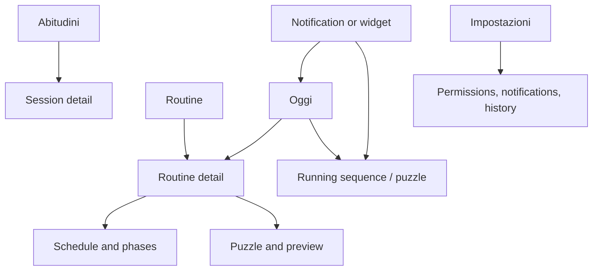

# Panik Attak V3 — product and implementation plan

**Planning draft · 24 October 2026 · Baseline: Alpha 1 / Android build 2.3**

This document proposes V3 in **four implementation steps**. The original session only designed and documented the work. Subsequent authorized implementation is recorded in the updates below; the remaining recommendations are design defaults, not features already delivered.

**Implementation update — 24 October 2026:** the user subsequently chose the notification improvement first. Build **3.0-alpha.2** delivers the notification portion of step 2: persisted running-occurrence state, a silent status between recalls, multi-routine summary, protected alarm actions and cleanup. Pages, event history, statistics and widget remain planned. The current summary opens the existing routine screen; Oggi navigation will follow with the page split. Android 14+ permits individual dismissal while unlocked, so the requested absolute swipe lock cannot be guaranteed. See [device verification](../TEST-REPORT-v3-notifications.md).

**Navigation update — 24 October 2026:** build **3.0-alpha.3** implements the multi-page infrastructure: Oggi, Routine, routine detail, Abitudini placeholder, and **an empty Impostazioni page explicitly reserved for phase 3**. Oggi shows the earliest recall across enabled routines, ties, running occurrences and up to three other scheduled routines. Single-routine status notifications open the matching detail; summaries open Oggi. Back navigation, page/scroll restoration and portrait/landscape were tested on Samsung. Existing editors and permission controls remain in routine detail for now. Global settings, statistical history, widget and a future unified draft editor remain deferred; this does not claim every broader acceptance item below is complete. See [page verification](../TEST-REPORT-v3-pages.md).

**Settings update — 24 October 2026:** at the user's request, build **3.0-alpha.4** fills the Settings page with essential working controls. Sound shows the current alarm volume and links to Android audio/DND controls. Notifications exposes alarm-channel settings, a silent sequence-status switch (on by default), and lock-screen routine names (off by default). Reliability shows exact-alarm/full-screen access and battery guidance with Android links. Values refresh on return; unsupported system screens fall back to app information. The optional status switch never stops alarms or bypasses a puzzle. The previous routine-detail permissions card now links here. History recording, retention, export and deletion remain deferred until the statistics implementation; no empty history controls have been added. See [settings verification](../TEST-REPORT-v3-settings.md).

## Direction

V3 should answer four questions clearly: **What will happen next? Which routine controls it? How do I usually respond? Can I see the current state without opening the app?**

Keep the Italian interface, offline operation, multiple simultaneous routines, and puzzle protection. Keep the current palette pending the separate colors discussion. No account, cloud analytics, sleep tracking, scores, or social features in this release.

### The four steps

| Step | Deliverable | Why this order |
| --- | --- | --- |
| 1 | Separate pages and organize settings | Establish understandable navigation and ownership of controls. |
| 2 | Explicit sequence state, ongoing notification, and event history | Give the app, notification, statistics, and widget the same reliable facts. |
| 3 | Habits charts, session history, and history settings | Build statistics on the events introduced in step 2; add history controls to the essential Settings page delivered in Alpha 4. |
| 4 | Home-screen widget and V3 integration checks | Reuse the same state and protected actions instead of creating another scheduler. |

Steps 3 and 4 depend on step 2. Each step should leave a working app and have its own validation before moving on.

## Step 1 — pages and settings

### Recommended navigation

Use three bottom-navigation destinations with visible text labels:

| Page | Italian label | Main purpose |
| --- | --- | --- |
| Today | **Oggi** | Next alarm and sequences currently running, across all routines. |
| Routines | **Routine** | Create and configure independent schedules. |
| Habits | **Abitudini** | Understand puzzle responses and sequence stopping patterns. |

**Impostazioni** opens from a gear in the top app bar. Settings are infrequent maintenance, so they do not need a fourth bottom tab. Puzzle previews belong to the routine editor, not another top-level page. During step 1, Habits has an honest “history arrives with V3 tracking” empty state; no sample data presented as real history.

Alpha 3 initially left the Settings body empty for phase 3. The user's subsequent request brought essential Settings forward into Alpha 4: sound, notification preferences and reliability links now live here, with an entry point from routine detail and the setup warning on Oggi. Only history settings still depend on phase 3.

### Oggi: the daily landing page

Content order:

1. A current-sequence card, **only when an occurrence is running**: routine name, phase, ringing/waiting state, next recall, and pending-puzzle count. With overlapping sequences, show a compact card per running occurrence and an overall count.
2. A next-alarm card: nearest actual scheduled recall **across all enabled routines**, routine name, local date/time, and `hh:mm:ss`. Equal-time alarms show “+1 routine” and reveal both on tap. Keep the countdown directly above the action area.
3. A compact list of the remaining upcoming occurrences, limited to three initially, with “Vedi routine”. Avoid listing every minute-level recall on this page.
4. A configuration warning only when something needs attention. Move the permanent permission explanations into Settings.

Actions: open the correct routine; open a pending puzzle; enter the protected pause/stop flow. If no routine is enabled, show “Nessuna routine attiva” and “Scegli una routine”. If a timer reaches zero, show the actual reconciled state rather than a negative duration or a fictitious next alarm.

**Important change from Alpha:** selecting a routine must not hide an earlier alarm from a different routine on Oggi. The routine detail can still have its own countdown.

### Routine: list and detail

The list contains name, first time, selected weekdays, enabled/paused state, and the next occurrence. Keep one “Nuova routine” action. Row tap opens detail; the switch controls that specific routine. A three-dot menu holds rename, duplicate, and delete.

Routine detail contains four compact sections:

| Section | Controls |
| --- | --- |
| Schedule | First alarm, weekdays, own next recall/countdown. |
| Phases | Start/end, interval, fixed-time choice where supported, sequence preview. |
| Puzzle | Type, simple/hard preview, optional escalating difficulty. |
| Sound | Vibration; explanation/link for the system alarm sound and volume. |

The detail page carries the routine name prominently. Use a dedicated phase editor page or the existing focused dialog; do not put every phase's controls inline. Keep Material time picking and the improved dialog buttons.

Routine creation and duplication remain paused by default. Use a draft editor with Save/Cancel; abandoned changes do not alter scheduled alarms. The edit authorization is scoped to the routine and edit session. Revalidate on Save if the routine or current occurrence changed while the editor was open. Renaming does not change scheduling; modifying active schedules, phases, puzzle, escalation, or pausing/deleting an active routine keeps the existing challenge protection.

### Alarm experience stays separate

The full-screen puzzle remains a focused screen without bottom navigation. Show the routine identity and other pending recalls. Solving one routine must never dismiss another. Notification and widget entry points open this same screen, not a second implementation of the puzzle gate.

Keep the existing distinction between solving a puzzle and accepting its effect: a solved recall may still require **Spegni solo questa**. A stale answer must not dismiss a newer recall. Back navigation and draft state must survive rotation/process recreation without regenerating the current puzzle.

### Settings ownership and recommended defaults

| Setting | Location | V3 decision / default |
| --- | --- | --- |
| Name, weekdays, start time, phases | Routine detail | Per routine; preserve current values during migration. |
| Puzzle type and difficulty growth | Routine detail | Per routine; escalation off for new routines. |
| Vibration | Routine detail | Per routine; preserve current value, on for new routines. Also honor it for puzzle error feedback belonging to that routine. |
| Alarm sound and volume | Settings → Sound | Initially show system controls and open Android settings. Do not add a custom sound library in V3. |
| Call-ringer behavior | Settings → Sound | Explain existing activation behavior and DND access. Do not add a bypass toggle that silently changes the established wake-up contract. |
| Running-sequence status notification | Settings → Notifications | On by default; silent. Optional status channel can be disabled independently of ringing alerts. |
| Upcoming-alarm notification | Not in V3 scope | Do not leave an all-day status notification just because a routine is enabled. |
| Routine names on lock screen | Settings → Notifications | Default to hiding names on the lock screen; show generic sequence status there. Android visibility settings remain authoritative. |
| Notification permission, exact alarms, full-screen access, battery | Settings → Reliability | Display real status and links to Android controls; these are not fake in-app switches. |
| Save habit history | Settings → History | Proposed default on, with a plain first-use explanation that history stays on-device. Can be turned off without disabling alarms. No retroactive reconstruction. |
| History retention | Settings → History | Default 365 days; choices 30 / 90 / 365 days. Explain and confirm deletion when shortening the period. |
| Export / erase history | Settings → History | Export CSV via the system share/save flow; confirm erasure. Separate from deleting routines. |
| Date range and routine filter | Abitudini | View filters, not global settings. Remember the last choice; default last 30 days / all routines. |
| Widget scope | Per-widget configuration | Default all enabled routines; optional pinned routine. Multiple widget instances are independent. |
| Colors and theme | Deferred | Keep the existing dark theme until the separate color discussion. |

Protection rules should not become user-disableable settings in this release. Avoid adding separate choices for every chart style, animation speed, notification refresh interval, or statistics threshold.

### Step 1 acceptance

- Every Alpha control has a clear destination; routine state and schedules migrate unchanged.
- Oggi shows the nearest alarm across all routines, including ties, and every editor opens the correct routine.
- Back, rotation, large text, narrow screens, empty state, and protected edits work without losing a draft or bypassing a puzzle.
- Test the Alpha countdown on a physical device: its last release was built successfully but that new feature was not device-tested because the Samsung was disconnected.

## Step 2 — sequence state, notification, and trustworthy history

### What “running a sequence” means

A **routine** is a saved repeating configuration. A **session** is one occurrence of that routine. An enabled routine scheduled for tomorrow is not a session running today.

| State | Meaning | Status notification |
| --- | --- | --- |
| Scheduled | Enabled, but this occurrence has not delivered its first recall. | None. |
| Ringing | At least one delivered recall for this session is unresolved. | Ringing notification; opens the pending puzzle. |
| Between recalls | First recall has happened, current recall solved, more recalls remain in this session. | Silent ongoing sequence-status notification. |
| Stopped for this occurrence | User successfully chose Ferma la mattina. | Remove this session's status; later days remain enabled. |
| Paused during session | User passed the pause gate. | Remove this session's status; future occurrences disabled. |
| Finished | No pending recall and no more recalls in this occurrence. | Remove this session's status. |
| Unknown / interrupted | Delivery or continuity cannot be established. | Reconcile actual schedule; do not claim success or invent a stop time. |

Passing the configured end time does **not** finish a session if its last alarm still rings. Conversely, after the last scheduled recall is resolved, there is no need to keep the notification until an arbitrary end-of-phase timestamp. The status between recalls survives closing the app and is reconstructed from persisted state.

Keep session identity separate from the current queue entry. Alpha coalesces an unresolved recall into the next recall of the same routine; V3 must preserve the superseded recall as a historical event before replacing it. If a later occurrence starts while an older one is unresolved, explicitly mark the older occurrence interrupted/superseded, never successfully solved, and keep other routines isolated.

### Notification design

Alpha already has a foreground-service notification **while audio is ringing**. V3 adds the missing continuity **between recalls**, rather than creating a duplicate ringing service.

Example between recalls:

> **Lavoro · Sequenza in corso**  
> Ci siamo · Prossimo richiamo alle 08:05  
> Apri sequenza

During ringing, the existing alarm notification gives the routine and its own phase, pending count, and a route to its puzzle. Do not label one routine with another routine's higher phase merely because the combined audio is more urgent.

Recommended multi-routine presentation: one stable status summary, expanding to show the running routines and next recall for each. While an alarm is sounding, its foreground notification takes priority; the silent summary covers any remaining waiting sessions, so the same session is not announced twice. When no alarms sound, the silent summary represents all running sessions.

Use separate channels for urgent **Sveglie** and silent **Sequenze in corso**. Channel behavior is user-controlled in Android; do not recreate channels to override the user's choices. [Android notification channels](https://developer.android.com/develop/ui/views/notifications/channels)

- Tap opens the exact running session or, for a multi-session summary, the running list on Oggi.
- Optional “Ferma la mattina” action opens the existing challenge for the captured session ID; it never stops anything directly from the notification.
- Dismissing a notification does not pause or solve the sequence. Ongoing notifications can be dismissible on newer Android versions, so persistence is a state guarantee, not a promise that a card cannot be swiped away. Respect dismissal until a meaningful next state transition; do not spam it back. [Android 14 behavior changes](https://developer.android.com/about/versions/14/behavior-changes-all#non-dismissable-notifications)
- The status notification does not wake the screen, play sound, or create an always-running foreground service. Keep the audio service for actual ringing.
- Update from state changes: delivery, resolution, stop, pause, routine changes, restart, and clock/time-zone changes. Use an absolute next-recall time; no per-second background polling.
- Reconcile terminal states explicitly and cancel stale cards. If a boundary callback is required, it must be separate from audible recall delivery and must never create a puzzle or sound.
- Denied status permission must not invent a visible-notification guarantee. Preserve the app's alarm-readiness checks and expose the blocked channel/permission in Settings.

### Event model to collect now, so statistics work later

Use a local structured history store with stable IDs; do not grow a single preferences JSON blob indefinitely. Keep scheduling/queue state authoritative and history recording short and recoverable. A journal/outbox with idempotent replay avoids duplicate records after retries. A history-write failure must not prevent an alarm from sounding or being dismissed.

| Entity | Minimum information |
| --- | --- |
| Session | Session ID; routine ID; name/configuration snapshot; occurrence start anchor; first scheduled recall; expected recalls; recording coverage; terminal reason and timestamp if known. |
| Recall | Recall ID; session ID; phase; scheduled time; delivery time; queue-entry time; first puzzle-display time; puzzle type/difficulty; resolved or superseded status. |
| Action | Event ID; session/recall/challenge IDs; purpose; timestamp; accepted/rejected outcome; entry source (app, notification, widget). |
| Timing context | UTC timestamp; local date/time and UTC offset; time-zone ID; monotonic elapsed time and boot identity for valid duration measurements. |

Relevant events: occurrence scheduled/revised/cancelled; recall delivered; puzzle first displayed; puzzle attempt wrong; puzzle solved; recall dismissal accepted; stop-occurrence accepted; pause accepted; session finished; recall superseded; continuity lost. Record active-visible puzzle duration if we want a solving-effort metric. First display time alone cannot establish how long the user actively worked on the puzzle.

Separate challenge purposes: **recall, stop occurrence, pause, edit, preview, test**. A successful pause/edit challenge is not a solved alarm. Preview puzzles and 12-second test alarms never enter habit charts. Store only timing, classification, and aggregate attempt counts—not answer text or every tap.

A solved puzzle and a successful action are distinct. Log an accepted dismissal only after validating the current routine/recall identity; reject stale callbacks without counting a success. Record whether a recall was waiting behind another routine before its puzzle could be displayed.

### Persistence and time rules

- History starts when recording is enabled. Alpha contains current state but no reliable historical solve log; do not fabricate earlier days.
- Preserve IDs and snapshots through routine rename, duplicate, or deletion. Deleting a routine leaves its existing history under its historical name unless the user also erases that history.
- Attribute an overnight session to its scheduled start date. Its events can occur after midnight; do not split the session into two mornings.
- Preserve the time zone at the event. Relative-duration charts use real elapsed time; local-time charts explain that points reflect the local clock at the event. Clock changes/reboots invalidate unsupported monotonic spans rather than creating negative times.
- If recording is toggled mid-session, mark coverage partial. Partial sessions may appear in the timeline but are excluded from metrics requiring complete observation.
- Keep the existing direct-boot alarm storage available. Detailed history belongs in credential-protected storage; use a minimal device-protected event outbox until first unlock, then import once and remove it. Only the necessary IDs/times/state belong there. [Android Direct Boot storage](https://developer.android.com/privacy-and-security/direct-boot)
- Expiry and erase operations cover both stored history and pending outbox events; turning recording off must also stop future ingestion of events collected after opt-out.

### Step 2 acceptance

A real device test must cover a running session with multiple gaps, overlapping routines, solving only one recall, stopping one occurrence, pausing one routine, notification dismissal, denied channel, process recreation, boot/first unlock, schedule changes, and a still-ringing final recall after the planned end. Replaying an event creates one history row, not two. Notification and history failures never silence an unresolved alarm.

## Step 3 — habits and statistics

### What timestamps can and cannot tell us

With a **solve timestamp alone**, we can count recorded solutions and show their distribution by clock time, date, and weekday. To say how long a response took, we also need the scheduled/delivered/displayed timestamps. To say when a sequence stopped, we need the **accepted stop or terminal action**, not simply the last solution seen so far.

Call the page **Abitudini**, and describe the data as “risposte alle sveglie” or “fine delle sequenze”. Do not call a puzzle solution a measured wake-up time. We cannot infer getting out of bed, sleep duration/quality, bedtime, attentiveness, or medical conclusions from these events.

### Recommended page layout

1. Period chips **7 / 30 / 90 giorni** and routine filter **Tutte / selected routine**.
2. Three summary cards: median time to first accepted dismissal; median time to explicit stop; percentage of complete observed sessions that reached Panic Mode. Each card includes its sample size; explicit-stop card also shows how many sessions actually used that action.
3. Main chart **Quando termini la sequenza**.
4. A compact ending-time distribution answering **A che ora la termini più spesso?**
5. A phase breakdown and weekday summary.
6. Session history; tap a row for its event timeline and ending reason.

Progressively disclose puzzle-type comparisons and detailed timing inside session detail or a collapsed “Dettagli” section. Do not turn the default screen into a dashboard of dozens of numbers.

### Graphs worth building

| View | Definition and interaction |
| --- | --- |
| Session timeline / scatter plot | X = scheduled session date; Y = minutes since its first scheduled recall. One mark for first accepted dismissal and a distinct mark for accepted explicit stop, or final resolution if the session finished normally. Toggle “Ora locale” for clock times. Tap shows routine, timestamps, phase, ending reason, and coverage. |
| Ending-time histogram | Default explicit **Ferma la mattina** actions, one event per session, in 30-minute local-clock bins. Toggle to completed sequences or pause actions; never silently combine the three. Show counts and denominator, not just a highlighted “usual time”. |
| Puzzle-solving time distribution | Optional view of first solved recall per session, using the actual solved timestamp, in 30-minute local-time bins. A separate “All recall solutions” view counts all solved recall puzzles; label it as puzzle count because longer sessions contribute more events. Pause/edit/test/preview solutions remain excluded. |
| Phase distribution | Number/proportion of explicit stops in each phase, with separate counts for natural completion, pause, and unknown outcomes. A second summary can show sessions that ever reached Panic Mode. |
| Weekday summary | Median minutes to first accepted dismissal for Mon–Sun, split by routine when selected; show n and unavailable days. Relative time is more comparable than raw 07:30 vs 09:00 schedules. |
| Session detail | Planned start → delivered recalls → displayed puzzles → solutions → accepted dismissal/stop/pause. Include queue waits and superseded recalls, with a readable text alternative to the graph. |

For local-clock plots, unwrap times relative to each session's start when crossing midnight; label the next-day offset. Never average 23:55 and 00:05 as noon. For a typical clock time, use the modal histogram bin, showing tied bins when appropriate. Global plots keep routine identity visible; do not present a mixture of work and weekend schedules as one personal target.

### Metric dictionary

| Metric | Calculation / denominator | What it means |
| --- | --- | --- |
| First response delay | First accepted recall dismissal − first scheduled recall, per session; median of complete valid samples. | Delay from the intended start to first resolved recall. Includes delivery and interaction delay. |
| Response after delivery | First accepted dismissal − first actual delivered recall, per session. | Delay after observed delivery, shown in detail to distinguish late Android delivery. |
| Time to explicit stop | Accepted Ferma la mattina timestamp − first scheduled recall; median over sessions with that accepted action. | When users intentionally end that occurrence, not all session endings. |
| Last resolution time | Final accepted recall dismissal when there are no remaining recalls or pending puzzles. | A normal completion; never inferred from the latest solve of an unfinished session. |
| Delivery delay | Actual delivered time − scheduled time per recall. | Diagnostic context; not a habit score. Flag invalid clock spans. |
| Puzzle completion delay | Solved time − first displayed time, same challenge. | Wall time since display, including interruptions; label accordingly. |
| Active puzzle time | Sum of foreground-visible monotonic spans until solution, only when measured completely. | Optional detailed interaction metric; compare within puzzle type, difficulty, and purpose. |
| Stop-after-solve delay | Accepted dismissal − solved timestamp for the same recall. | Time between solving and pressing the dismissal button. |
| Recalls before first response | Count of unique delivered recalls up to first accepted dismissal. | How many recalls were delivered before the first resolution; not proof they were heard. |
| Unresolved-at-next-recall count | Recall superseded by another delivered recall of that routine/session while still pending. | Observable unresolved recalls; do not count another routine's recall as ignoring this one. |
| Panic reach rate | Complete observed sessions with at least one delivered phase-4 recall ÷ all complete observed started sessions. | How often the app reached Panic Mode; show numerator and denominator. |
| Ending reasons | Counts of explicit stop, normal finish, pause, superseded/interrupted, and still running. | Descriptive outcome breakdown. Do not turn “pause” or missing data into failure. |
| Common stopping time | Most populated 30-minute bin of accepted explicit stops in the selected period/routines. | Clock-time habit, with sample size and ties. |
| Consistency | Interquartile range of first-response delay, within the selected routine. | Variation in recorded responses; not a sleep-health rating. |

“Complete observed” means the entire session has reliable recording coverage and a terminal outcome; it does not mean the user performed well. A deliberately paused session can be complete and belongs in the denominator of Panic reach rate; a still-running or unknown session does not. Do not use unscheduled days as failures, and do not infer historical schedules from a routine's current weekdays.

### Avoid misleading summaries

- Show raw history immediately. Until there are at least five valid samples for a summary, show the sample count and “Dati ancora pochi” rather than declaring a stable habit. This is a product-display rule, not a statistical significance claim.
- At zero samples, show an empty state; at missing data, show a gap, never zero minutes.
- Do not connect missing dates with a line that implies observation. Accessible labels and text tables carry the same information as charts; color alone never identifies an outcome.
- Compare periods only with at least five qualifying sessions in each, matching routine and metric definition. Say “median response was 4 minutes earlier”, not “sleep improved”.
- No punitive streaks, ranking, invented wake-up scores, or “best puzzle” claims based on incomparable difficulty settings.
- Filter/export must apply the same purpose, coverage, outcome, and time-zone rules as the visible charts.

### Step 3 acceptance

Use a deterministic event fixture covering different weekdays, overlap, midnight, DST/time-zone changes, renamed/deleted routines, duplicate broadcasts, test/preview challenges, partial recording, late delivery, pause, unknown and still-running sessions. Hand-calculate the expected chart points, bins, medians, and denominators and compare them to the rendered results. Also test empty/one-sample history, filters, retention, export, erase, and large-text/table alternatives. Do not test real habit claims with fabricated personal history.

## Step 4 — widget and integration

### First widget: next alarm + current status

Ship **one resizable widget family**, not multiple unrelated widgets. Compact target approximately 2×2 cells; expanded approximately 4×2, subject to launcher sizing.

| State | Compact content | Expanded content |
| --- | --- | --- |
| Upcoming | Routine name, day/time, “Prossima sveglia”. | Also weekdays and count of other enabled routines. |
| Running between recalls | Routine name, “Sequenza in corso”, next recall time. | Current phase and other running routines. |
| Ringing | “Sveglia in corso”, target routine, Apri puzzle. | Number of additional pending recalls. |
| No enabled routine | “Nessuna routine attiva”, Apri routine. | Same, with room for explanatory text. |
| Pinned routine deleted | “Routine non disponibile”, Configura. | Do not silently switch to another routine. |

Per-instance configuration: **all enabled routines** by default, or **one pinned routine**. All-routines mode prioritizes currently ringing sessions, then waiting sessions, then the earliest upcoming alarm, matching Oggi. Equal-time alarms have an additional-routine count. Initial V3 widget excludes habit charts to keep the wake-up shortcut readable.

The displayed date/time is the primary reliable information. Do not promise an app-driven `hh:mm:ss` widget countdown: Android periodic widget updates cannot run every second, and `updatePeriodMillis` does not support intervals below 30 minutes. Refresh on real state changes; use periodic reconciliation as a fallback, not as the alarm scheduler. A system-rendered countdown can be explored later only if it behaves correctly across supported launchers. [Android widget updates](https://developer.android.com/develop/ui/views/appwidgets/advanced)

### Actions and protection

Tap the alarm area to open Oggi or the pinned routine. If ringing, “Apri puzzle” opens the current validated recall. A pause/stop shortcut, if included in the expanded version, always opens the in-app challenge for that session; no one-tap bypass. Activating a paused routine goes through the normal permission/readiness and call-ringer checks. If history was erased or the routine was deleted, stale widget actions fail safely and offer navigation.

The widget is a display and entry point, not a background service. Keep the current Java/View architecture and use native widget facilities; a full Compose rewrite is not needed for this feature. Update instances when relevant routines change, alarms are delivered/resolved, the date/time zone changes, or the app/device restarts. Read state from the same source as notifications and Oggi.

### Step 4 acceptance and release gate

- Verify compact/expanded layouts, resize, font scaling, multiple instances, pinned deletion, switching routine, and launch from a locked device where supported.
- Test on Samsung One UI and an Android stock-style launcher. Exercise overnight waits, process death, reboot, permissions denied, DST/time-zone changes, and same-time alarms without relying on minute-by-minute polling.
- Verify page, notification, and widget agree about the routine, state, next recall, and pending count after every action.
- Keep the widget useful when status notifications or history recording are disabled.
- Run existing alarm/puzzle/routine regressions, validate migration from Alpha 1, and confirm test data/preferences are restored.
- Build a signed update compatible with the installed Alpha, replace the local APK, and publish a new Alpha release only as part of an authorized implementation/release session. Repository visibility remains unchanged.

## Concrete walkthrough

Lavoro first recalls at 08:00. Its puzzle is solved at 08:02:10, then the dismissal is accepted at 08:02:15. The next recall is 08:10, so the sequence remains running and a silent status card stays visible. The user later passes Ferma la mattina at 08:12:00.

The session records first response delay **2m15s**, time to explicit stop **12m**, a **5s** solve-to-dismiss delay for the first recall, and an explicit stop in the **08:00–08:29** clock-time bin. It does not claim the user woke up at 08:02:10. If Weekend is also running, its notification state and statistics remain independent.

## Decisions to review before implementation

The plan recommends three main tabs plus Settings; a notification only for sessions that have actually started; local history enabled with a clear explanation and 365-day retention; and a single widget family with optional routine pinning. These defaults make the four steps implementable without expanding scope. Colors remain a separate discussion. No estimates are committed until these product choices are settled.
